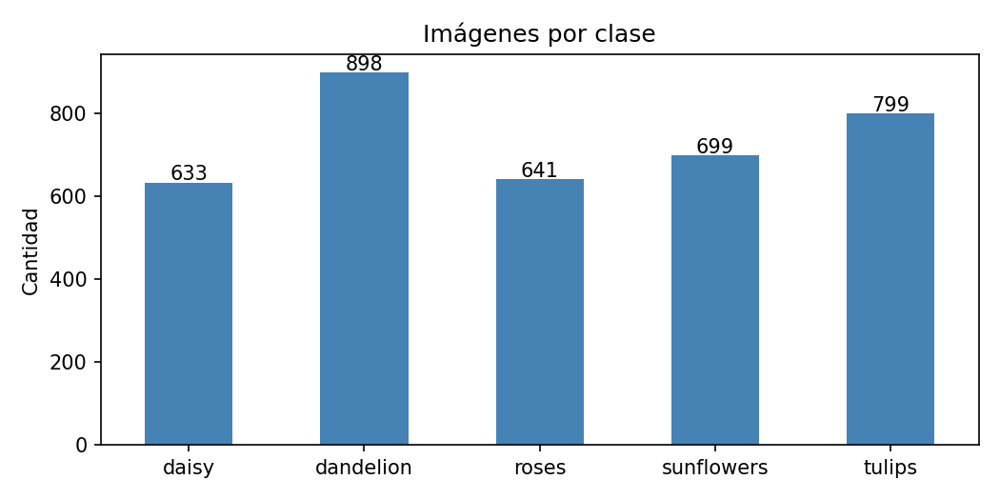
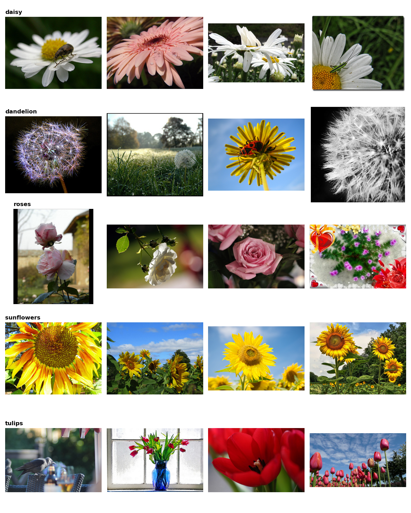
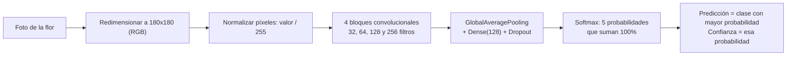
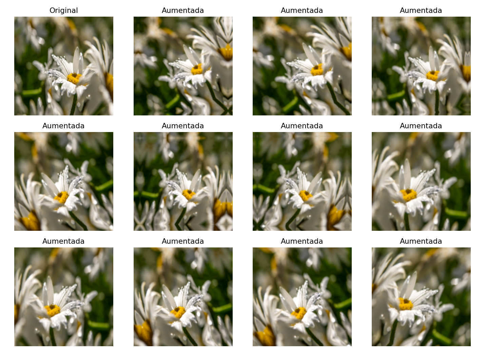
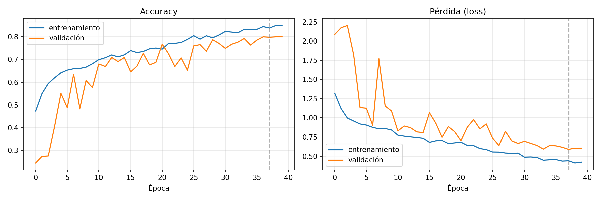
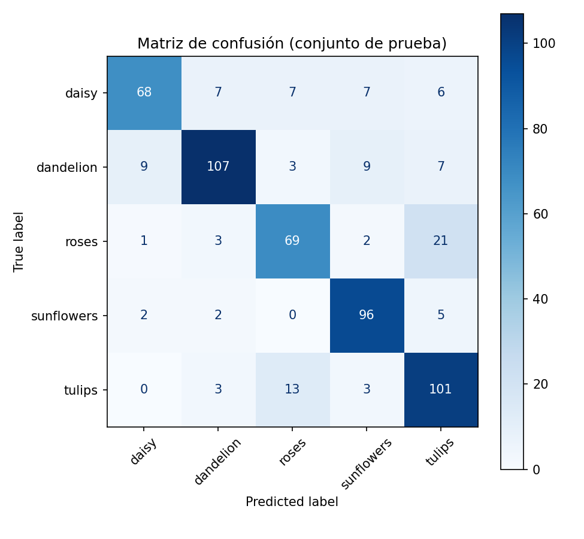
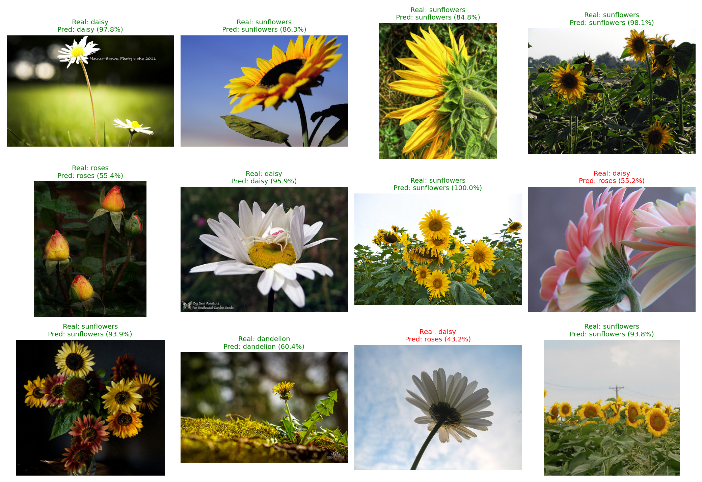
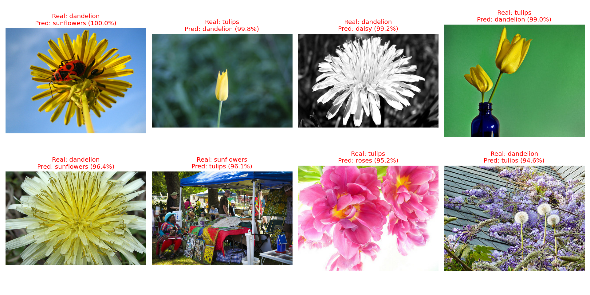

# 🌼 Clasificador de flores con una CNN (TensorFlow/Keras + Streamlit)

Proyecto de Deep Learning: una **Red Neuronal Convolucional** entrenada desde cero para clasificar fotografías de flores en **5 clases** (margarita, diente de león, rosa, girasol y tulipán), con una **aplicación Streamlit** que carga el modelo entrenado, recibe una imagen y muestra la **clase predicha y su nivel de confianza**.

## 1. Dataset
**flower_photos** (publicado por el equipo de TensorFlow): fotos de flores organizadas en 5 carpetas.
Se descarga automáticamente desde `https://storage.googleapis.com/download.tensorflow.org/example_images/flower_photos.tgz`.
No se incluye en el repositorio (`data/` está en `.gitignore`).

| Clase | Español |
|---|---|
| daisy | Margarita |
| dandelion | Diente de león |
| roses | Rosa |
| sunflowers | Girasol |
| tulips | Tulipán |

## 2. Estructura del repositorio
```
.
├── notebooks_colab/
│   └── (notebook .ipynb)                     # Experimentación completa, ejecutada en Google Colab
├── src/
│   ├── config.py      # Hiperparámetros y rutas
│   ├── data.py        # Descarga, partición train/val/test y pipeline tf.data
│   ├── model.py       # Arquitectura de la CNN + data augmentation
│   ├── train.py       # Entrenamiento y guardado del modelo
│   ├── evaluate.py    # Evaluación en test (métricas y figuras)
│   ├── predict.py     # Predicción de una imagen (CLI y reutilizado por Streamlit)
│   └── plots.py       # Gráficas
├── app/
│   └── streamlit_app.py                      # Aplicación web
├── models/
│   ├── flower_cnn.keras                      # Modelo entrenado
│   └── class_names.json                      # Orden de las clases
├── reports/
│   ├── metrics.json  history.json            # Métricas e historial de entrenamiento
│   └── figures/                              # Gráficas generadas
├── requirements.txt
└── README.md
```

## 3. Metodología
1. **Exploración:** balance de clases, ejemplos, tamaños de imagen, integridad de archivos y estadísticas de píxeles.
2. **Preprocesamiento:** decodificación RGB, redimensionado a 180×180 y normalización `/255` (capa `Rescaling` dentro del modelo, así la app no puede olvidarla).
3. **División estratificada** con semilla fija: 70 % entrenamiento / 15 % validación / 15 % prueba.
4. **Data Augmentation** (solo en entrenamiento): volteo horizontal, rotación, zoom y contraste.
5. **Arquitectura:** 4 bloques `[Conv→BN→ReLU]×2→MaxPool` (32-64-128-256 filtros) → GlobalAveragePooling → Dropout → Dense(128) → Dropout → Softmax(5).
6. **Entrenamiento:** Adam, `sparse_categorical_crossentropy`, EarlyStopping (restaura los mejores pesos) y ReduceLROnPlateau.
7. **Evaluación:** accuracy, precisión/recall/F1 por clase, F1 macro y matriz de confusión sobre el conjunto de prueba.
8. **Predicciones:** 12 imágenes de prueba con clase real, clase predicha y probabilidad.

### 3.1 Exploración del dataset

| Balance de clases | Ejemplos por clase |
|---|---|
|  |  |

Las imágenes tienen tamaños y proporciones muy variables (345 tamaños distintos), por eso se redimensionan todas a 180×180.

### 3.2 ¿Cómo decide el modelo qué flor es?

Cuando se carga una foto (en el notebook o en la app Streamlit), esto es lo que ocurre:



1. **Preparación:** la imagen se convierte a RGB, se redimensiona a 180×180 y sus píxeles se llevan del rango 0–255 a 0–1.
2. **Extracción de características:** los bloques convolucionales aplican filtros que la red *aprende* durante el entrenamiento. En una CNN, las primeras capas suelen responder a patrones simples (bordes, colores, texturas) y las más profundas los combinan en patrones más complejos (formas de pétalos, centros de la flor). Este comportamiento es el típico de las CNN; no se midió en este modelo en particular.
3. **Clasificación:** las características se resumen y pasan por capas densas. La última capa (softmax) entrega **una probabilidad por clase** y las 5 suman 100 %.
4. **Resultado:** la clase predicha es la de mayor probabilidad, y ese valor es el **nivel de confianza** que muestra la app. Por ejemplo, si el modelo da girasol 86 %, rosa 8 %, tulipán 3 %, margarita 2 % y diente de león 1 %, la predicción es *girasol* con 86 % de confianza.

**Data Augmentation:** durante el entrenamiento, cada foto se voltea, rota, amplía y cambia de contraste de forma aleatoria. Así el modelo aprende a reconocer la flor y no a memorizar fotos concretas. Estas transformaciones se apagan al predecir.



## 4. Resultados
Resultados reales sobre el **conjunto de prueba** (551 imágenes que el modelo nunca vio ni para entrenar ni para ajustar el entrenamiento). Fuente: `reports/metrics.json`.

| Métrica | Valor |
|---|---|
| Accuracy | **80.04%** |
| F1 macro | **79.71%** |
| Pérdida (loss) | 0.561 |

| Clase | Precisión | Recall | F1 | Imágenes |
|---|---|---|---|---|
| Margarita (`daisy`) | 85.0% | 71.6% | 77.7% | 95 |
| Diente de león (`dandelion`) | 87.7% | 79.3% | 83.3% | 135 |
| Rosa (`roses`) | 75.0% | 71.9% | 73.4% | 96 |
| Girasol (`sunflowers`) | 82.1% | 91.4% | 86.5% | 105 |
| Tulipán (`tulips`) | 72.1% | 84.2% | 77.7% | 120 |

**Lectura de los resultados**
- El entrenamiento corrió las 40 épocas; los pesos finales son los de la mejor época (la 38, menor `val_loss`). Entrenamiento ≈ 84 % vs validación ≈ 80 %: la brecha es pequeña, por lo que **no hay sobreajuste importante**.
- Las curvas seguían mejorando lentamente al final, así que con más épocas o *transfer learning* habría margen de mejora.
- Las confusiones principales son **rosa ↔ tulipán** (21 rosas predichas como tulipán y 13 tulipanes como rosa), flores de forma y color parecidos.
- La mejor clase es girasol (F1 ≈ 86 %); la más difícil es rosa (F1 ≈ 73 %).

### 4.1 Curvas de entrenamiento


### 4.2 Matriz de confusión (conjunto de prueba)


Las filas son la clase real y las columnas la clase predicha. La diagonal son los aciertos. Fuera de la diagonal destaca la confusión entre rosas y tulipanes.

### 4.3 Predicciones con imágenes del conjunto de prueba


Verde = acierto, rojo = error. En esta muestra aleatoria de 12 imágenes hay 10 aciertos y 2 errores (dos margaritas predichas como rosa, con confianza de solo 55 % y 43 %). Es una muestra ilustrativa; el desempeño real del modelo es el de las métricas de arriba (80,04 % de accuracy sobre 551 imágenes).

### 4.4 Errores con mayor confianza


Imágenes mal clasificadas donde el modelo estaba más seguro; sirven para analizar en qué casos falla.

Todas las figuras están en `reports/figures/`.

### 4.5 Pruebas de la aplicación Streamlit
Se probó la app con imágenes que **no pertenecen al dataset**: una rosa, un tulipán, un girasol y un avión (imagen que no es una flor, para ver cómo se comporta el modelo con una clase desconocida).

En cada captura se ve la imagen cargada, la clase predicha, el nivel de confianza y la probabilidad de cada clase.

**Prueba 1: rosa**


**Prueba 2: tulipán**


**Prueba 3: girasol**


**Prueba 4: avión (no es una flor)**


## 5. Cómo ejecutarlo

### Requisitos
- **Python 3.11 a 3.13** (probado con 3.12 y 3.13). **No usar Python 3.10 ni anterior**: Keras 3.13.2, con el que se guardó el modelo, requiere Python 3.11 o superior.
- El modelo se entrenó en Google Colab con Python 3.13, TensorFlow 2.21.0 y Keras 3.13.2 (versiones fijadas en `requirements.txt`).

```bash
git clone https://github.com/santamaria314k/Red-Neuronal-Convolucional-CNN-.git
cd Red-Neuronal-Convolucional-CNN-
```

**Windows**
```bash
py -3.13 -m venv .venv
.venv\Scripts\activate
pip install -r requirements.txt
```

**Mac / Linux**
```bash
python3 -m venv .venv
source .venv/bin/activate
pip install -r requirements.txt
```

### A) Solo usar la aplicación (el modelo ya está en `models/`)
```bash
streamlit run app/streamlit_app.py
```
Se abre en `http://localhost:8501`. Sube una imagen JPG/PNG y verás la clase predicha, la confianza y la probabilidad de cada clase.

### B) Reproducir el entrenamiento en Google Colab
1. Abre el notebook de la carpeta `notebooks_colab/` en Colab (en colab.research.google.com: *Archivo → Subir cuaderno*, o desde la pestaña *GitHub*).
2. *Entorno de ejecución → Cambiar tipo de entorno → GPU*.
3. *Ejecutar todo*. Al final se genera y descarga `resultados_colab.zip` con `models/` y `reports/`.

### C) Reproducir el entrenamiento desde la terminal
```bash
python -m src.train          # descarga el dataset, entrena y guarda models/flower_cnn.keras
python -m src.evaluate       # métricas y figuras sobre el conjunto de prueba
python -m src.predict ruta/a/una_imagen.jpg
```
Parámetros opcionales: `--epochs N`, `--data-dir RUTA/flower_photos`.

## 6. Limitaciones
- El modelo solo conoce 5 clases: ante una imagen de otra cosa siempre devolverá una de ellas, y **puede hacerlo con una confianza alta** (la probabilidad softmax no es una medida fiable de certeza fuera de las 5 clases). La app avisa solo cuando la confianza es baja.
- Dataset pequeño y resolución 180×180; mejoras posibles: *transfer learning*, clase "otro", búsqueda de hiperparámetros.
